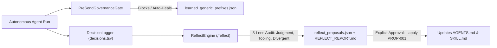

# `pstack-telemetry` — Self-Healing Agent Harness, TSV Decision Trails & Pre-Send Governance

[](LICENSE)
[](https://www.python.org/)
[](https://github.com/andrew4522-cr/pstack-telemetry)

> **Stop silent agent drift.** `pstack-telemetry` is a zero-dependency Python runtime and agent skill suite that turns Lauren Tan's (`@poteto/pstack`) `/show-me-your-work` and `/reflect` standards into an executable, self-healing governance harness for unattended AI agents and outbound B2B pipelines.

Built by **Andrew Anderson** ([BridgingTheAIGap.com](https://www.bridgingtheaigap.com)).

---

## Why `pstack-telemetry` Exists

Everyone running scheduled or autonomous AI agents eventually hits the same failure mode: **silent agent drift**.
- An outbound agent sends an email with raw `{first_name}` template braces or pitches `info@` / `dataprotection@` shared inboxes.
- A LinkedIn agent synthesizes a DM where the contact's headline company doesn't match the target company.
- An LLM report generator drops the `owner/` prefix from GitHub URLs (`https://github.com/repo` instead of `https://github.com/owner/repo`).
- A background task fails at 5:00 AM, or a cold outreach campaign launches for a $49 product whose conservative unit economics ceiling is $33/month.

Prompting the LLM to *"be careful"* does not fix structural drift. **`pstack-telemetry` encodes lessons directly into deterministic Python gates and an approval-gated reflection loop.**

---

## Architecture Overview



---

## Core Capabilities

### 1. Canonical TSV Decision Trails (`DecisionLogger` — `/show-me-your-work`)
- **Single-Line Auditability:** Every decision logs a structured row to `decisions.tsv`:
  ```tsv
  ts	phase	decision	why	evidence	result
  ```
- **Automatic Cross-Run `start` Boundary Protocol:** When a new agent run appends to an existing `decisions.tsv` written by an earlier run, `DecisionLogger` automatically inserts a `phase=start` boundary row recording the prior run's timestamp range and the new `run_id`.
- **Formula-Injection Sanitization:** Automatically sanitizes cells beginning with `=`, `+`, `-`, or `@` so `decisions.tsv` is safe to open in Excel/Google Sheets.

### 2. Pre-Send Outbound & Structural Self-Healing (`PreSendGovernanceGate`)
- **Template Placeholder Auto-Healing:** Detects and heals unreplaced `{first_name}` and `{company}` braces before dispatch.
- **Recursive Generic Inbox Blocklist (`learned_generic_prefixes.json`):** Blocks 75+ generic/departmental email prefixes (`info@`, `careers@`, `dataprotection@`, `tellmemore@`, `complaints@`) and persists newly discovered non-human tokens at runtime.
- **Safe Human First-Name Extraction (`extract_safe_first_name`):** Prevents awkward salutations like *"Hi Operations,"* or *"Hi Marketing Lead,"* by validating human first names against role suffixes and learned salutation blocklists.
- **Headline-to-Company Verification:** Verifies extracted company tokens across all headline separators (`at`, `@`, `-`, `–`, `|`) before sending any LinkedIn DM.
- **GitHub Markdown Self-Healing (`verify_and_heal_github_markdown`):** Automatically repairs bare headers and single-segment truncated GitHub URLs generated by LLMs.
- **5-Minute Campaign Unit Economics Gate (`validate_campaign_unit_economics`):** Runs conservative cold-outreach math (30% open, 2.5% CTR, 1.5% conversion) to kill non-viable low-ticket campaigns before a single credit is spent.

### 3. Three-Lens Post-Execution Reflection (`ReflectEngine` — `/reflect`)
- Audits `decisions.tsv`, SQLite databases, and task statuses across three lenses:
  1. **Judgment Reviewer**
  2. **Tooling & Reliability Reviewer**
  3. **Divergent / First-Principles Reviewer**
- **Strict Approval Gate:** `/reflect` *never* edits `AGENTS.md` or `SKILL.md` silently. It stages concrete proposals in `reflect_proposals.json` and `REFLECT_REPORT.md`, applying them only when you run `pstack-telemetry --apply <PROPOSAL_ID>`.

### 4. 7-Dimension Pitch Performance Learning (`PitchPerformanceTracker`)
- Tracks winning subject lines, high-affinity verticals, optimal UTC send hours, sender accounts, and verified first-name open-rate lift in `learned_pitch_performance.json`.

---

## Installation

```bash
pip install git+https://github.com/andrew4522-cr/pstack-telemetry.git
```

Or clone locally:
```bash
git clone https://github.com/andrew4522-cr/pstack-telemetry.git
cd pstack-telemetry
pip install -e .
```

---

## Quickstart

### Python SDK

```python
from pstack_telemetry import (
    DecisionLogger,
    PreSendGovernanceGate,
    ReflectEngine,
    verify_and_heal_github_markdown,
    validate_campaign_unit_economics,
)

# 1. Log a canonical decision checkpoint (/show-me-your-work)
dlog = DecisionLogger("decisions.tsv", script_name="morning_outreach")
dlog.log(
    phase="harvest",
    decision="harvested 42 verified executive leads",
    why="feed daily B2B outreach queue",
    evidence="db=outreach.db, count=42",
    result="PASS",
)

# 2. Enforce Pre-Send Governance Gates
gate = PreSendGovernanceGate("learned_generic_prefixes.json")
body, repairs = gate.heal_placeholders(
    "Hi {first_name}, saw {company} is scaling AI workflows.",
    contact_name="Operations Lead",  # Automatically falls back to 'there'
    company_name="Acme Corp",
)
check = gate.validate_outbound_message(
    recipient_email="sarah@acmecorp.com",
    subject="Quick question about Acme Corp",
    body=body,
    contact_name="Sarah Jenkins",
    headline="VP Operations at Acme Corp",
    target_company="Acme Corp",
)
assert check["valid"] is True

# 3. Run the 3-Lens Reflection Audit (/reflect)
reflect = ReflectEngine("decisions.tsv")
summary = reflect.run_reflection()
```

### CLI Usage

```bash
# Log a decision row from any shell script or cron job
pstack-telemetry --log \
  --script "daily_scanner" \
  --phase "verify_heal" \
  --decision "verified 10 GitHub repository links" \
  --why "prevent broken markdown links in daily report" \
  --evidence "report=daily_intel.md, repairs=0" \
  --result "PASS"

# Inspect the last 20 rows of decisions.tsv
pstack-telemetry --tail 20

# Run the 5-minute campaign unit economics kill test (6,000 sends/mo at $49 vs $1,500)
pstack-telemetry --unit-economics 6000 49
pstack-telemetry --unit-economics 6000 1500

# Run the 3-lens reflection audit and generate REFLECT_REPORT.md
pstack-telemetry --reflect

# Approve and apply a staged skill/rule proposal
pstack-telemetry --apply PROP-001
```

---

## Bundled Agent Skills (`skills/`)

Copy the [`skills/`](skills/) directory into your `.claude/skills/`, `.cursor/skills/`, or `~/.gemini/config/skills/` folder to equip your coding agent with:
- [`skills/show-me-your-work/SKILL.md`](skills/show-me-your-work/SKILL.md)
- [`skills/reflect/SKILL.md`](skills/reflect/SKILL.md)
- [`skills/campaign-forensics/SKILL.md`](skills/campaign-forensics/SKILL.md)

---

## Running Tests

```bash
python -m unittest discover -s tests -v
```

---

## License

MIT License © 2026 [Andrew Anderson](https://www.bridgingtheaigap.com)
